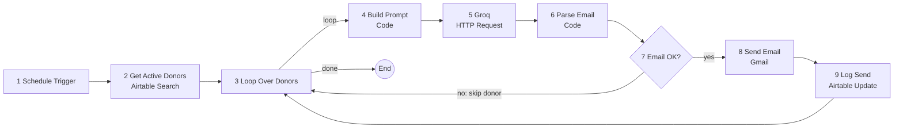

# NGO Donor Engagement Automation

A monthly workflow that reads donors from Airtable, writes each one a personalised update email with a Llama 3.3 model on Groq, checks the email for problems, sends it through Gmail, and records what was sent. Built with n8n Cloud, Airtable, Groq and Gmail. 

| | |
|---|---|
| **Author** | Shubhi Agarwal |
| **Capstone project** | Project 17, NGO Donor Engagement Automation |

> Hope Foundation is a fictional organisation. Every donor in this repository is invented. All email addresses are the author's own test aliases.

## The problem

A small NGO with one or two staff cannot write personal messages to every donor. Mass emails feel generic, and generic emails contribute to donor fatigue and lower renewal. The goal here is a repeatable monthly process that gives each donor a message that refers to their own cause and history, at no marginal cost per email.

## The solution

Once a month the workflow:

1. Finds donors who are `Active` and have not been contacted in the last 25 days.
2. For each donor, asks an AI model to write a short email using only the donor's first name, impact area, giving-since year, last-gift month, a personal note, and one approved update line for their impact area.
3. Checks the model's output. Anything broken, off-length, containing currency, or containing a number that was not supplied is blocked.
4. Sends approved emails through Gmail.
5. Writes the send date and the email text back to Airtable.

## Architecture

A static version is in [`docs/architecture.png`](docs/architecture.png).

## Tools and why each was chosen

| Tool | Role | Why this one |
|---|---|---|
| n8n Cloud | Orchestrates the workflow | Visual, no-code, and it is the platform named in the brief |
| Airtable | Donor table and send log | A spreadsheet-like interface a non-technical NGO worker can edit |
| Groq (Llama 3.3 70B) | Writes the email text | Free tier, fast, JSON output mode. |
| Gmail | Sends the email | Free and familiar to NGO staff |
| GitHub | Hosts the submission |  |

## What each node does

| # | Node | Type | Purpose |
|---|---|---|---|
| 1 | Schedule Trigger | Trigger | Starts the run on the 1st of each month at 9:00 |
| 2 | Get Active Donors | Airtable, Search | Returns donors whose Status is Active and who were not contacted in the last 25 days |
| 3 | Loop Over Donors | Loop Over Items | Passes one donor at a time to the next nodes |
| 4 | Build Prompt | Code | Builds the AI request from one donor record. Sends the first name only |
| 5 | Groq | HTTP Request | Calls the Groq chat API, with retries |
| 6 | Parse Email | Code | Parses the AI reply and runs the safety checks |
| 7 | Email OK? | IF | Sends approved emails on. Skips the rest |
| 8 | Send Email | Gmail | Sends the email |
| 9 | Log Send | Airtable, Update | Records today's date and the email text |

## Safety and quality controls

- **Opt-out respected:** only `Active` donors are selected, so `Unsubscribed` and `Lapsed` donors are never emailed.
- **No double sending:** donors contacted in the last 25 days are excluded, so a re-run does not email people twice.
- **Data minimisation:** the surname, email address and the amount given are not sent to the AI provider.
- **Approved facts only:** the AI is given one update line per impact area and told not to invent anything else.
- **Output gate:** the Parse Email node blocks an email that is empty, not valid JSON, missing a field, shorter than 40 or longer than 220 words, contains a currency symbol, contains a leftover placeholder, has a bad address, or contains a number that is not in the donor data or the update line.
- **Fail safe:** a blocked donor is skipped and is not marked as contacted, so they are retried next run.
- **Retries:** the Groq call retries up to three times.
